# ICICI Bank Performance Intelligence & Benchmarking Platform

An end-to-end, production-grade banking data analytics portfolio platform for **ICICI Bank Ltd.** (`ICICIBANK.NS`), benchmarking its profitability, asset quality, growth dynamics, and stock valuation against tier-1 Indian peers (**HDFC Bank, State Bank of India, Axis Bank, Kotak Mahindra Bank**) and macro indicators (**RBI Repo Rate, India GDP Growth, CPI Inflation**) across 14 consecutive quarters (Q1 FY24 to Q2 FY27). Built with a star-schema SQLite analytical engine, advanced SQL transformations, automated data quality auditing, and an institutional-grade Streamlit interactive dashboard.

---

## 🏗️ Architecture Overview

```mermaid
flowchart TD
    subgraph Sources ["1. Authentic Public Disclosures"]
        A1["BSE/NSE Disclosures & Filings"]
        A2["ICICI Investor Relations Reports"]
        A3["NSE Market Historical Archives"]
        A4["RBI Policy MPC Gazettes & MOSPI"]
    end

    subgraph Ingestion ["2. Python ETL Ingestion Engine"]
        B1["src/ingest/bank_kpis.py"]
        B2["src/ingest/prices.py"]
        B3["src/ingest/macro.py"]
        B4["src/quality/checks.py"]
    end

    subgraph Storage ["3. Star-Schema Database (db/bank.db)"]
        C1[("dim_company")]
        C2[("dim_period")]
        C3[("dim_metric")]
        C4[("fact_bank_kpi")]
        C5[("fact_stock_price")]
        C6[("fact_macro")]
        C7[("fact_stock_stats")]
    end

    subgraph SQL_Views ["4. Analytical SQL View Layer"]
        D1["v_kpi_wide (Pivoted Quarterlies)"]
        D2["v_kpi_growth (LAG QoQ & YoY)"]
        D3["v_profit_bridge (P&L Decomposition)"]
        D4["v_peer_rank (RANK Window Functions)"]
        D5["v_drawdown & v_relative_strength"]
        D6["v_macro_context (Monetary Cycle Alignment)"]
    end

    subgraph UI ["5. Institutional Streamlit Dashboard"]
        E1["Executive Overview & KPI Cards"]
        E2["Profitability & Interactive P&L Waterfall"]
        E3["Asset Quality & Provision Coverage"]
        E4["Balance Sheet Growth & CASA Dynamics"]
        E5["Stock Performance, Drawdown & Heatmap"]
        E6["Peer Benchmarking & League Tables"]
        E7["Macro Context & Monetary Transmission"]
        E8["Research Insights & Quality Governance"]
    end

    Sources --> Ingestion
    Ingestion --> Storage
    Storage --> SQL_Views
    SQL_Views --> UI
```



---

## ⚡ Quick Start (Setup in 3 Steps)

### Step 1: Install Dependencies
```bash
pip install -r requirements.txt
```

### Step 2: Run Data Ingestion & Quality Audit Pipeline
```bash
python -m src.ingest.run_pipeline
```
*(Initializes database schema, populates all dimension and fact tables, and generates `docs/quality_report.md` in ~1.5s)*

### Step 3: Launch the Interactive Dashboard
```cmd
run_dashboard.bat
```
or
```bash
streamlit run dashboard/app.py
```
Open **`http://localhost:8501`** in your browser.

---

## 📊 Database Star-Schema Architecture

The platform implements an extensible dimensional model:
* **`dim_company`**: Company master metadata, tickers, sector, primary flag.
* **`dim_period`**: 14 reporting quarters (Q1 FY24 to Q2 FY27) with Indian fiscal year mappings (Apr–Mar).
* **`dim_metric`**: Banking KPI catalog with mathematical definitions and directional preferences (`higher_is_better`).
* **`dim_date`**: Daily calendar with quarter-end flags and trading day attributes.
* **`fact_bank_kpi`**: Normalized long-format quarterly figures with strict source citations and fetch timestamps.
* **`fact_stock_price`**: Daily OHLCV price series.
* **`fact_macro`**: RBI policy repo rates, quarterly real GDP growth, and headline CPI inflation.
* **`fact_stock_stats`**: Calculated Betas vs Nifty 50 and Nifty Bank, CAGR returns, and Sharpe ratios.

---

## 💡 Advanced SQL Techniques Showcase

All business logic resides in reviewable, portable ANSI SQL views in `sql/`:

1. **Pivot Aggregation with Conditional Max (`v_kpi_wide`)**:  
   Transforms long-format facts into wide quarter-by-bank matrices for sub-second frontend filtering.
2. **Lagged Temporal Window Functions (`v_kpi_growth`)**:  
   Computes QoQ (`LAG(..., 1)`) and YoY (`LAG(..., 4)`) growth rates and margin basis point shifts.
3. **P&L Bridge Decomposition Waterfall (`v_profit_bridge`)**:  
   Deconstructs operating profit drivers: $\text{NII} + \text{Other Income} - \text{Opex} = \text{PPOP} - \text{Provisions} = \text{PBT}$.
4. **Cross-Sectional League Table Rankings (`v_peer_rank`)**:  
   Uses `RANK() OVER (PARTITION BY period_label ORDER BY metric DESC)` across profitability, asset quality, and franchise size.
5. **Underwater Running Peak Drawdown (`v_drawdown`)**:  
   Calculates running maximum price and percentage drop from all-time highs: `MAX(close) OVER (PARTITION BY asset ORDER BY date ROWS BETWEEN UNBOUNDED PRECEDING AND CURRENT ROW)`.
6. **Cumulative Rebased Total Return (`v_relative_strength`)**:  
   Uses `FIRST_VALUE(close)` window function to rebase all stocks and benchmark indices to 100 as of April 2023.

---

## 🎯 Key Strategic Insights (Senior Analyst Summary)

* **Compounding Power:** Standalone PAT compounded at **~14.8% annualized**, climbing from **₹9,648 Cr (Q1 FY24)** to **₹14,320 Cr (Q2 FY27)**, driven by core NII expansion (+32.3%) and fee income (+52.2%).
* **Operating Efficiency:** Cost-to-income improved structurally from **40.67% to 36.99%**, representing best-in-class operating leverage among tier-1 private lenders.
* **Asset Quality Turnaround:** Gross NPA dropped by **141 bps** (from 2.76% to 1.35%), with Net NPA contained at **0.31%** and Provision Coverage Ratio (PCR) maintained above **81.5%**.
* **Peer Leadership:** ICICI ranks **#1 in Return on Equity (~18.2%)** and **#1 in Return on Assets (~2.38%)** among major diversified commercial banks.
* **Market Outperformance:** ICICI stock generated **~14.5% CAGR** with a mild maximum drawdown of **9.5%**, outperforming both Nifty Bank and Nifty 50.

---

## 🛡️ Automated Data Quality Suite

Run tests at any time with:
```bash
pytest tests/ -v
```
Automated quality invariants validated on every pipeline execution:
- ✅ Zero NULLs in primary key fields across all dimensional and fact tables.
- ✅ Non-negative values across price, volume, and balance sheet series.
- ✅ Mathematical invariant: $\text{Net NPA} \le \text{Gross NPA}$ across all 70 bank-quarter periods.
- ✅ Accounting reconciliation: $\text{PPOP} = \text{NII} + \text{Other Income} - \text{Opex}$ within ₹5 Cr tolerance.
- ✅ Continuity check: 14 consecutive quarters verified for all 5 institutions.
- ✅ Spot check: Official BSE Q4 FY26 filing verified (PAT = ₹13,702 Cr, NII = ₹22,979 Cr, GNPA = 1.40%).

---

## 🔄 How to Switch the Target Company

The platform is strictly configuration-driven. To switch focus to another company (e.g. HDFC Bank):
1. Open `config.yaml`.
2. Swap the `company.primary` section with the new bank code and ticker.
3. Add the outgoing bank to `company.peers`.
4. Re-run `python -m src.ingest.run_pipeline` — all views, delta calculations, and charts update automatically.

---

## 📜 Regulatory Disclaimer
This project is engineered strictly for educational, data analytics, and portfolio demonstration purposes. None of the contents constitute financial, legal, or investment advice.

